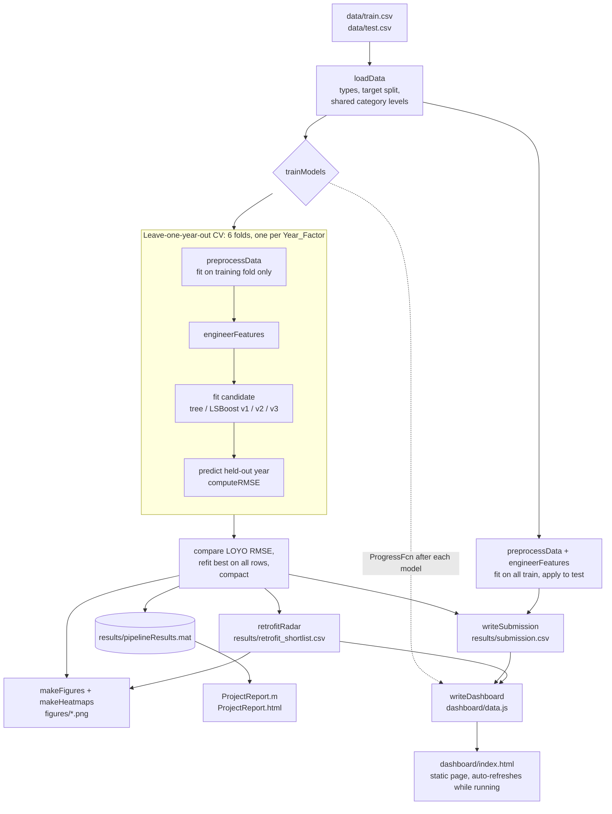

# Architecture

## Overview

`main.m` is the official entry point. It runs five stages, each a function in `src/`, and then turns the model into the **Retrofit Radar** shortlist, presentation figures and heatmaps. Throughout the run it updates a static **dashboard** (`dashboard/index.html`). `ProjectReport.m` is a live script that explains the results without retraining.

The repository also contains an **independent cross-check pipeline** (`step01`–`step05`), described at the end of this document.

## Modules

| File | Stage | Responsibility |
| --- | --- | --- |
| `main.m` | Entry point | Seed, paths, runs every stage in order, saves results |
| `src/loadData.m` | 1. Ingest | `readtable` with explicit types; categorical `Year_Factor`, `State_Factor`, `building_class`, `facility_type`; separate `site_eui` and `id`; give train and test the same category levels |
| `src/preprocessData.m` | 2. Clean and impute | `Year_Factor` → number; `year_built == 0` → missing; `<name>_missing` flags; `energy_star_rating` filled by facility-type median; other gaps filled by the overall median. Fit on train, apply to both |
| `src/engineerFeatures.m` | 3. Features | Shared by both pipelines. Tables with a numeric `Year_Factor` (from `preprocessData`) go to `src/engineerLegacyFeatures.m`: `building_age` (capped 0–100), `floor_area_x_hdd`, `floor_area_x_cdd`, `energy_star_x_floor_area`. The cross-check pipeline's cleaned tables get its five features |
| `src/crossValidateModel.m` | 4. Validate | Generic CV over any fold labels, with optional per-fold preparation; returns pooled RMSE, per-fold RMSE and out-of-fold predictions |
| `src/trainModels.m` | 4. Select | Candidate list, LOYO for all, random 5-fold for the tree, `try/catch` fallback, refit and `compact` the winner; optional `ProgressFcn` reports each model's score as it finishes |
| `src/computeRMSE.m` | 4. Metric | RMSE with input validation |
| `src/writeSubmission.m` | 5. Submit | Predict, clamp at 0, check values, write and read back `id,site_eui` (9,705 × 2) |
| `src/retrofitRadar.m` | Impact | Actual vs expected EUI for the latest year, excess MWh/yr, ranked shortlist CSV |
| `src/makeFigures.m` | Impact | Five PNGs for the slides and report (light theme, `exportgraphics`) |
| `src/makeHeatmaps.m` | Impact | Four matrix diagnostics: feature correlation, prediction-error heatmap (the regression version of a confusion matrix), excess EUI by state × facility type, mean residual by year × state |
| `src/makeIterationFigures.m` | Impact | Model journey bar chart and the model × held-out-year RMSE heatmap |
| `src/makeTestCorrelationHeatmap.m` | Impact | 30 × 30 correlation heatmap for `test.csv`: predicted `site_eui` (joined from `submission.csv`) and the 29 non-constant numeric features most correlated with it, pairwise on missing values |
| `src/computeExtendedMetrics.m` | Impact | MAE, MSE, RMSE, R² and median absolute error on out-of-fold predictions → `results/extended_metrics.csv` |
| `src/simulateNTULandmarks.m` | Impact | What-if for NTU's The Hive and The Arc (estimated inputs, hottest training climate) → `figures/ntu_landmarks.png`, `results/ntu_landmarks.csv` |
| `src/writeDashboard.m` | Outputs | Serialises the dashboard struct to `dashboard/data.js` (`jsonencode`), written atomically |
| `src/summarizeForDashboard.m` | Outputs | Final headline numbers, per-state radar summary, shortlist, submission profile, cross-check scores |
| `dashboard/index.html` | Demo | Static results page (no server, no external libraries); reloads every 8 s while `status` is `running` |
| `ProjectReport.m` | Demo | Live-script walkthrough, exported to HTML |

## Key design decisions

**Validation mirrors the test set.** Every test row is `Year_Factor` 7, which never appears in training, and the test set has no State_6 buildings, although they are 67% of training. Random k-fold mixes years, and the same building appears in several years, so its error estimate is optimistic. Holding out one year at a time is the closest simulation of the real task.

**Preprocessing lives inside the folds.** `trainModels` passes `preparePredictors` to `crossValidateModel`, so medians and flags are learned from each training fold alone. Fitting preprocessing on all the data first hid about 2.4 RMSE of error for the baseline tree (58.6 → 61.0 once fixed).

**`Year_Factor` is numeric.** As a category, the unseen level 7 would carry no information. As a number, trees place year 7 alongside the most recent years. Trees do not extrapolate trends; they treat year 7 like the latest years they saw.

**Only meaningful features are added.** Floor area × degree days approximates the total seasonal heating and cooling load; Energy Star × floor area captures the scale of efficiency. Wind-vector features were rejected because 88–94% of test wind and fog values are missing.

**The final model is compact.** `compact()` strips training data from the model, keeping `results/pipelineResults.mat` small.

## Model iteration log

LOYO RMSE (lower is better), from the full run of `main.m` (seed 42).

| # | Model | Change | LOYO RMSE | CV time |
| --- | --- | --- | --- | --- |
| 1 | Regression tree | Baseline, `fitrtree` defaults | 61.02 | 1.2 min |
| 2 | LSBoost v1 | 300 trees, LR 0.1, MaxNumSplits 63, MinLeafSize 20 | 41.06 | 9.6 min |
| 3 | LSBoost v2 | Shrinkage: 400 trees, LR 0.05, MinLeafSize 50, NumBins 50 | 41.85 | 4.0 min |
| 4 | **LSBoost v3** | Feature selection: v1 without 36 monthly temperature columns | **40.12** | 6.5 min |

What we learned:
- Boosting cut error by 33% compared with a single tree.
- Shrinkage (v2) did not help; it was slightly worse than v1 in 5 of 6 years.
- Removing the monthly temperature columns (v3) helped, and gave the best result in 5 of 6 years. This supports the idea that those columns let the trees memorise state-year combinations.
- The baseline tree scores 50.29 under random 5-fold against 61.02 under LOYO: random folds understate the error by 10.7.

## Outputs

| Path | Produced by | Committed |
| --- | --- | --- |
| `results/submission.csv` | `writeSubmission` | yes |
| `results/retrofit_shortlist.csv` | `retrofitRadar` | yes |
| `figures/1-5_*.png` | `makeFigures` | yes |
| `figures/6-9_*.png` | `makeHeatmaps` | yes |
| `figures/10-11_*.png` | `makeIterationFigures` | yes |
| `figures/12_test_correlation_30x30.png` | `makeTestCorrelationHeatmap` | yes |
| `figures/ntu_landmarks.png`, `results/ntu_landmarks.csv` | `simulateNTULandmarks` | yes |
| `results/extended_metrics.csv` | `computeExtendedMetrics` | yes |
| `dashboard/data.js` | `writeDashboard` | yes (the completed run) |
| `ProjectReport.html` | `export` of `ProjectReport.m` | yes |
| `results/pipelineResults.mat` | `main.m` | no (gitignored, regenerated) |

## 3D building simulator (model in the browser)

`dashboard/simulator.html` lets you click 3D models of NTU's The Hive and The Arc and run the final model on them live.

| File | Responsibility |
| --- | --- |
| `tools/buildSimulator.m` | Loads `results/pipelineResults.mat` and calls `exportModelForWeb` (about 1 minute, no retraining) |
| `src/exportModelForWeb.m` | Flattens all 300 trees (split variable, threshold, children, leaf value, left and right category codes), exports category levels, climate-state baseline vectors and facility-type references to `dashboard/model.js`. **Self-check:** a MATLAB walk of the exported trees must equal `predict()` on all 9,705 test rows, or the export fails |
| `dashboard/predict.js` | Plain JavaScript: `encode()` mirrors `preprocessData` + `engineerLegacyFeatures` for one building; `predict()` walks the trees with MATLAB's rules (`x < cut` goes left; a category in neither branch stops at that node) |
| `tests/web/checkPredict.mjs` | Node.js check against `tests/web/model_check.json`: 500 encoded test rows plus 9 scenarios run through the full MATLAB pipeline. Current result: difference **0** |
| `tools/prepare_models.py` | Headless Blender: decimates the Meshy exports (The Arc 7.3M → 150k triangles, 245 MB → 11 MB), downsizes textures and writes base64 `dashboard/models/*.js` so the page works from `file://` |
| `dashboard/simulator.html` | three.js 0.170.0 (pinned, jsDelivr) scene with click/hover picking, a scan animation and an EUI colour tint. The panel and model work without 3D; if the CDN or WebGL is unavailable it falls back to building cards |

Outputs shown: predicted EUI, annual MWh (EUI × area × 0.293 kWh/kBtu), average power draw in kW (annual kWh ÷ 8,760), the percentile among training buildings of the same facility type, and an optional Retrofit Radar verdict when you enter a metered EUI.

## Independent cross-check pipeline

A teammate built a second, separate pipeline to cross-check the result (scripts in `crosscheck/`): `step01_ingest` → `step02_preprocess` → `step03_features` → `step04_train_evaluate` → `step05_predict_submit`. It uses its own loader (`loadBuildingData`), preprocessor (`fitPreprocessor` / `applyPreprocessor`), model comparison (`crossValidateModels`, `trainCandidate`) and exporter (`exportBuildingSubmission`), with unit tests in `tests/` (6/6 pass: `runtests('tests')`). Its design is documented in [docs/STEP_ARCHITECTURE.md](docs/STEP_ARCHITECTURE.md).

It validates with random 5-fold CV plus one temporal check (train on years 1–5, predict year 6), and selects 200 bagged trees. Its outputs are in `release/`: `model_comparison.csv` and `crosscheck_bag_submission.csv`.

On the shared year-6 holdout the two pipelines agree closely: **41.31** (official LSBoost v3) vs **41.54** (cross-check Bag). Two independent implementations landing within 0.25 RMSE is evidence that the result is robust rather than an artefact of one codebase. The official submission is `results/submission.csv` from `main.m`, because it is validated on all six held-out years rather than one.

## Related documents

- [README.md](README.md): results and how to run
- [GUARDRAILS.md](GUARDRAILS.md): integrity, security and responsible-use rules
- [docs/DESIGN_SPEC.md](docs/DESIGN_SPEC.md): the original design specification, written before implementation
- [docs/](docs/): team plan, presentation brief, cross-check results and architecture, resources and status

## Extending

- **Add a model:** add one entry to the `candidates` struct in `src/trainModels.m` with a name and a `@(X, y)` training function. It is automatically cross-validated, compared and eligible for selection.
- **Add a feature:** add a row-wise column in `src/engineerFeatures.m`. It is applied identically in every fold and to the test set.
