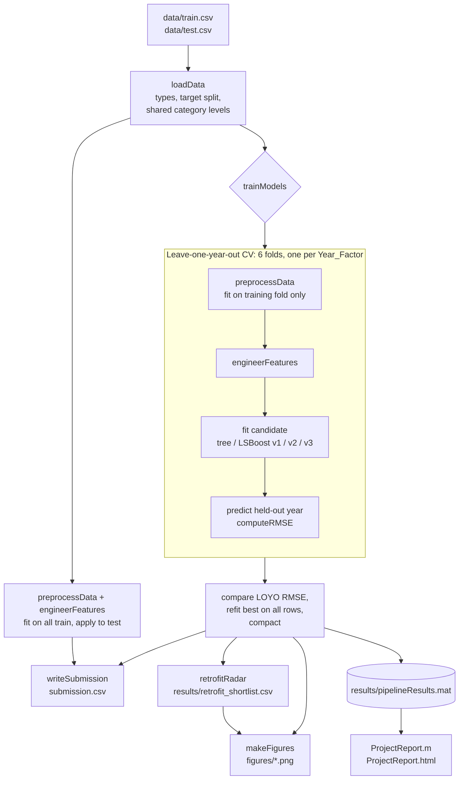

# Architecture

## Overview

`main.m` is the single entry point. It runs five stages, each a function in `src/`, and then turns the model into the **Retrofit Radar** shortlist and a set of presentation figures. `ProjectReport.m` is a live script that explains the results without retraining.

## Modules

| File | Stage | Responsibility |
| --- | --- | --- |
| `main.m` | Entry point | Seed, paths, runs every stage in order, saves results |
| `src/loadData.m` | 1. Ingest | `readtable` with explicit types; categorical `Year_Factor`, `State_Factor`, `building_class`, `facility_type`; separate `site_eui` and `id`; give train and test the same category levels |
| `src/preprocessData.m` | 2. Clean and impute | `Year_Factor` → number; `year_built == 0` → missing; `<name>_missing` flags; `energy_star_rating` filled by facility-type median; other gaps filled by the overall median. Fit on train, apply to both |
| `src/engineerFeatures.m` | 3. Features | `building_age` (capped 0–100), `floor_area_x_hdd`, `floor_area_x_cdd`, `energy_star_x_floor_area` |
| `src/crossValidateModel.m` | 4. Validate | Generic CV over any fold labels, with optional per-fold preparation; returns pooled RMSE, per-fold RMSE and out-of-fold predictions |
| `src/trainModels.m` | 4. Select | Candidate list, LOYO for all, random 5-fold for the tree, `try/catch` fallback, refit and `compact` the winner |
| `src/computeRMSE.m` | 4. Metric | RMSE with input validation |
| `src/writeSubmission.m` | 5. Submit | Predict, clamp at 0, check values, write and read back `id,site_eui` (9,705 × 2) |
| `src/retrofitRadar.m` | Impact | Actual vs expected EUI for the latest year, excess MWh/yr, ranked shortlist CSV |
| `src/makeFigures.m` | Impact | Five PNGs for the slides and report (light theme, `exportgraphics`) |
| `ProjectReport.m` | Demo | Live-script walkthrough, exported to HTML |

## Key design decisions

**Validation mirrors the test set.** Every test row is `Year_Factor` 7, which never appears in training, and the test set has no State_6 buildings, although they are 67% of training. Random k-fold mixes years, and the same building appears in several years, so its error estimate is optimistic. Holding out one year at a time is the closest simulation of the real task.

**Preprocessing lives inside the folds.** `trainModels` passes `preparePredictors` to `crossValidateModel`, so medians and flags are learned from each training fold alone. Fitting preprocessing on all the data first hid about 2.4 RMSE of error for the baseline tree (58.6 → 61.0 once fixed).

**`Year_Factor` is numeric.** As a category, the unseen level 7 would carry no information. As a number, trees place year 7 alongside the most recent years. Trees do not extrapolate trends; they treat year 7 like the latest years they saw.

**Only meaningful features are added.** Floor area × degree days approximates the total seasonal heating and cooling load; Energy Star × floor area captures the scale of efficiency. Wind-vector features were rejected because 88–94% of test wind and fog values are missing.

**The final model is compact.** `compact()` strips training data from the model, keeping `results/pipelineResults.mat` small.

## Model iteration log

LOYO RMSE (lower is better). Final numbers are filled in from the latest full run of `main.m`.

| # | Model | Change | LOYO RMSE |
| --- | --- | --- | --- |
| 1 | Regression tree | Baseline, `fitrtree` defaults | _see README_ |
| 2 | LSBoost v1 | 300 trees, LR 0.1, MaxNumSplits 63, MinLeafSize 20 | _see README_ |
| 3 | LSBoost v2 | Shrinkage: 400 trees, LR 0.05, MinLeafSize 50, NumBins 50 | _see README_ |
| 4 | LSBoost v3 | Feature selection: v1 without 36 monthly temperature columns | _see README_ |

## Outputs

| Path | Produced by | Committed |
| --- | --- | --- |
| `submission.csv` | `writeSubmission` | yes |
| `results/retrofit_shortlist.csv` | `retrofitRadar` | yes |
| `figures/*.png` | `makeFigures` | yes |
| `ProjectReport.html` | `export` of `ProjectReport.m` | yes |
| `results/pipelineResults.mat` | `main.m` | no (gitignored, regenerated) |

## Extending

- **Add a model:** add one entry to the `candidates` struct in `src/trainModels.m` with a name and a `@(X, y)` training function. It is automatically cross-validated, compared and eligible for selection.
- **Add a feature:** add a row-wise column in `src/engineerFeatures.m`. It is applied identically in every fold and to the test set.
