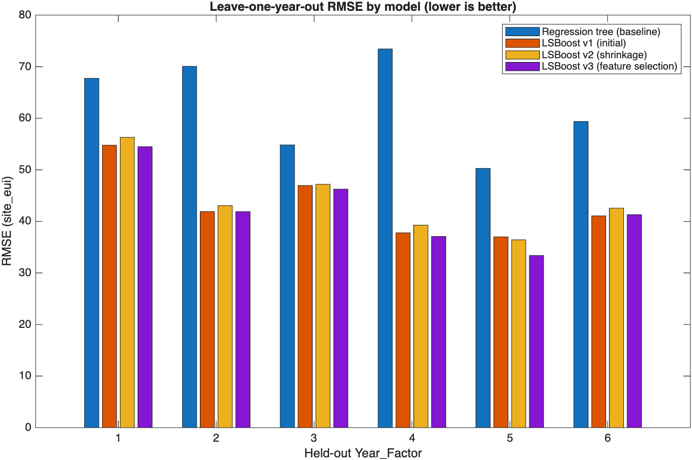

# Retrofit Radar: Predicting Building Energy Consumption with MATLAB

**Team MatrixNotFound** · Learn to Hack: MATLAB Edition 2026

We predict a building's **site energy use intensity** (`site_eui`) from its type, size, age and local climate using the WiDS Datathon 2022 data. Then we use those predictions to find the buildings that use the most energy beyond what similar buildings use. Those are the buildings an organisation should audit and retrofit first.


## Results

Leave-one-year-out cross-validation (LOYO): hold out one whole year, train on the other five, repeat for all six years. This mirrors the test set, which is a single year never seen in training.

| Model | What changed | LOYO RMSE |
| --- | --- | --- |
| Regression tree | Baseline (`fitrtree`) | 61.02 |
| LSBoost v1 | Gradient-boosted trees (`fitrensemble`, 300 trees, LR 0.1) | 41.06 |
| LSBoost v2 | Shrinkage: LR 0.05, 400 trees, min leaf 50, binning | 41.85 |
| **LSBoost v3** | **Feature selection: drop 36 monthly temperature columns** | **40.12** |

- **Selected model:** LSBoost v3, refit on all 75,757 training rows to predict the 9,705 test buildings (`submission.csv`). Boosting cut error by 33% compared with a single tree.
- **Why not random k-fold?** For the baseline tree, random 5-fold CV reports RMSE 50.29 against 61.02 under LOYO. Random folds mix years, and the same building appears in several years, so they understate the error by 10.7.
- **Leakage check:** fitting preprocessing inside each fold, instead of once on all the data, raised the tree's honest LOYO error from 58.6 to 61.0. The earlier number was flattered by leakage.
- **Retrofit Radar:** 1,316 of 22,449 buildings in the latest year (6%) use at least 50% more energy than the model expects. The top 50 account for 1,573 GWh/yr of excess use (`results/retrofit_shortlist.csv`).



## How it works

1. **Load** (`src/loadData.m`): typed `readtable`, categorical predictors, and the same category levels for train and test.
2. **Clean** (`src/preprocessData.m`):
   - `year_built = 0` is treated as missing.
   - `energy_star_rating` is filled by facility-type median, and other gaps by the overall median.
   - `<name>_missing` flags record where data was absent.
   - All statistics come from training rows only.
3. **Engineer** (`src/engineerFeatures.m`): building age, floor area × heating and cooling degree days (seasonal thermal load), and Energy Star × floor area. Four of these rank in the model's top 9 predictors.
4. **Select** (`src/trainModels.m`): a regression tree baseline and three LSBoost iterations, scored by LOYO. Preprocessing is refit inside every fold, and failures fall back to the next-best model.
5. **Submit** (`src/writeSubmission.m`): finite, non-negative predictions, checked as exactly 9,705 × 2 `id,site_eui`, with ids matched to the sample solution.
6. **Act** (`src/retrofitRadar.m`, `src/makeFigures.m`): actual vs expected EUI for the latest year, ranked by excess MWh per year, plus the presentation figures.

Details and diagrams: [ARCHITECTURE.md](ARCHITECTURE.md). Integrity, security and responsible-use rules: [GUARDRAILS.md](GUARDRAILS.md).

## Run it

Requires MATLAB (R2024b or newer) and the **Statistics and Machine Learning Toolbox**.

```matlab
main            % full pipeline, ~25-35 min (mostly LSBoost cross-validation)
ProjectReport   % walkthrough of the saved results, seconds
```

`main.m` writes:
- `submission.csv`
- `results/retrofit_shortlist.csv`
- `figures/*.png`
- `ProjectReport.html`
- `results/pipelineResults.mat` (gitignored; the compact model is about 4 MB)

The seed is fixed with `rng(42)`. More detail is in [SETUP.md](SETUP.md).

## Repository

| Path | Contents |
| --- | --- |
| `main.m` | Entry point |
| `src/` | Pipeline functions (one responsibility each) |
| `ProjectReport.m` / `ProjectReport.html` | Live-script report (our written demo) |
| `figures/` | Presentation figures |
| `results/retrofit_shortlist.csv` | Top 50 retrofit candidates |
| `submission.csv` | Test-set predictions |
| `docs/` | Team plan, presentation brief, resources, status |
| `DEVPOST_DRAFT.md` | Devpost submission text |
| `data/` | WiDS Datathon 2022 train/test/sample files |
| `BuildingRegressionModels.m`, PDFs | MathWorks starter material |

## Credits

- Data: [WiDS Datathon 2022](https://www.kaggle.com/competitions/widsdatathon2022), provided by the hackathon organisers.
- Starter material: Copyright 2025-2026 The MathWorks, Inc. (see `license.txt`).
- Team: Rohit, Matt, Shuan.
