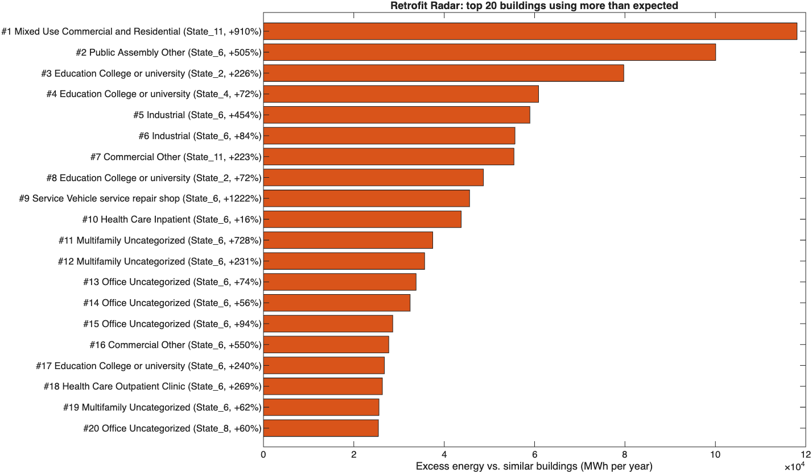
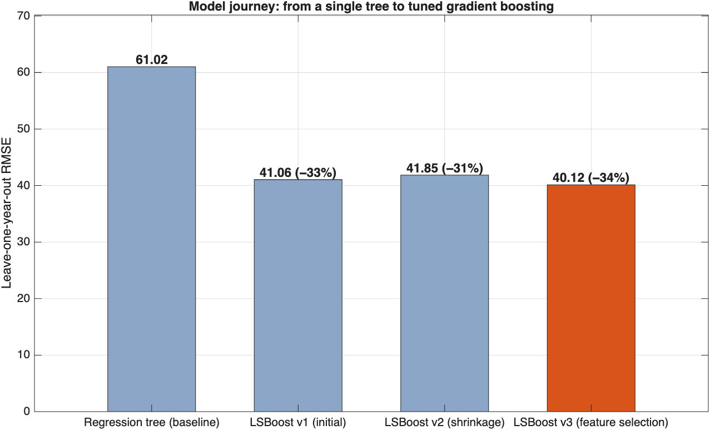
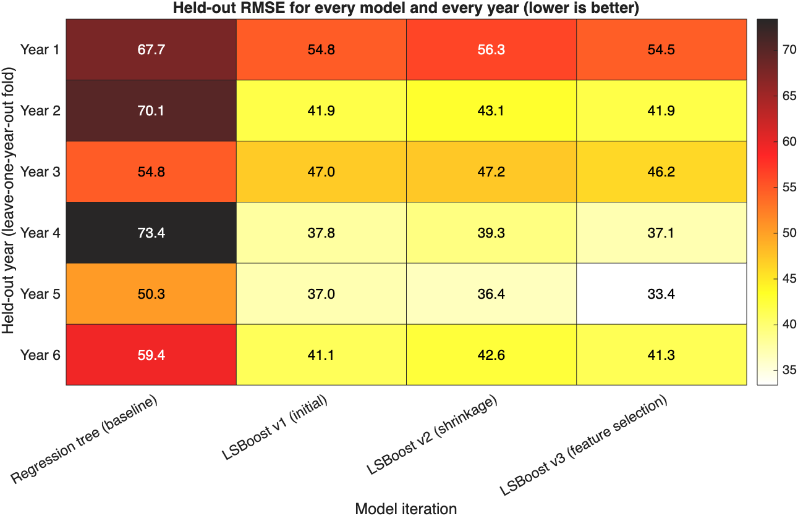
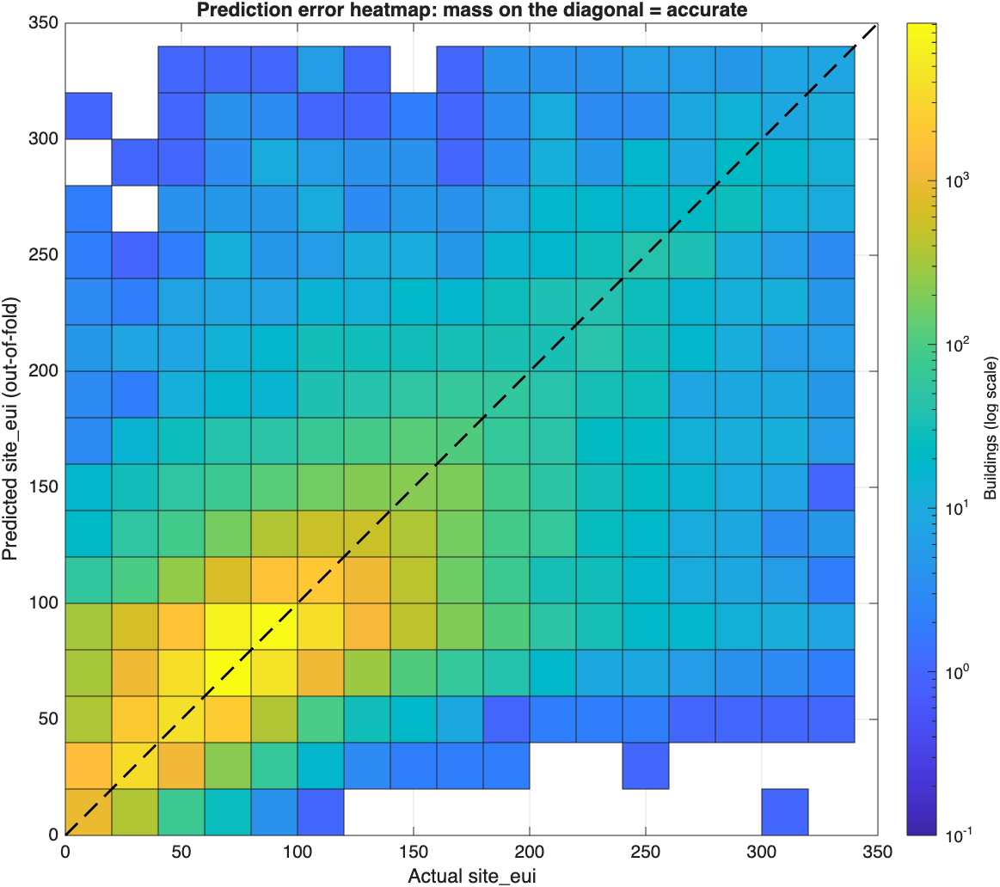
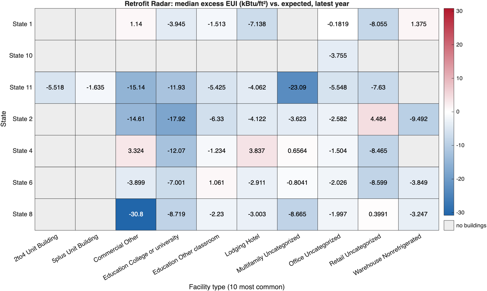

# Retrofit Radar: Predicting Building Energy Consumption with MATLAB

**Team MatrixNotFound** (Rohit, Matt, Shuan) · Learn to Hack: MATLAB Edition 2026

We predict a building's **site energy use intensity** (`site_eui`) from its type, size, age and local climate using the WiDS Datathon 2022 data. Then we use those predictions to find the buildings that use the most energy beyond what similar buildings use. Those are the buildings an organisation should audit and retrofit first.

## Start here

**Live site:** https://roh00t.github.io/MatrixNotFound/ · **Demo video:** https://youtu.be/bKo0Yp50wDo

| Open | What you get |
| --- | --- |
| [**Demo video (YouTube)**](https://youtu.be/bKo0Yp50wDo) | **5-minute presentation and live demo** |
| [`dashboard/index.html`](dashboard/index.html) | **Interactive results**: hover and toggle charts, a filterable retrofit shortlist, and the figure gallery. It updates live while `main.m` runs |
| [`dashboard/simulator.html`](dashboard/simulator.html) | **3D building simulator**: click NTU's The Hive or The Arc and our trained model runs **in your browser**, with live response curves |
| [`ProjectReport.html`](ProjectReport.html) | **Written walkthrough**: a MATLAB live script exported to HTML, with every figure |
| [`docs/START_HERE.md`](docs/START_HERE.md) | Run commands, the experiment families, and which outputs belong to which model |

**How the simulator works:** the 300-tree LSBoost ensemble is exported from MATLAB to JavaScript. Change floor area, age, Energy Star rating or climate and the predicted energy intensity, annual MWh and average power draw (kW) update instantly. A Node.js check confirms the browser model matches MATLAB's `predict()` exactly (difference 0 on 500 test rows and 9 full-pipeline scenarios).



## Results

Leave-one-year-out cross-validation (LOYO): hold out one whole year, train on the other five, repeat for all six years. This mirrors the test set, which is a single year (7) never seen in training.

| Model | What changed | LOYO RMSE |
| --- | --- | --- |
| Regression tree | Baseline (`fitrtree`) | 61.02 |
| LSBoost v1 | Gradient-boosted trees (`fitrensemble`, 300 trees, LR 0.1) | 41.06 |
| LSBoost v2 | Shrinkage: LR 0.05, 400 trees, min leaf 50, binning | 41.85 |
| **LSBoost v3** | **Feature selection: drop 36 monthly temperature columns** | **40.12** |

- **Official submission:** [`results/submission.csv`](results/submission.csv) from LSBoost v3, refit on all 75,757 training rows to predict the 9,705 test buildings. Boosting cut error by 34% compared with a single tree, and v3 was the best model in 5 of 6 held-out years.
- **Accuracy on unseen years (out-of-fold, v3):** MAE 21.0, median absolute error 12.6, RMSE 40.1, R² 0.53 (median building EUI ≈ 75 kBtu/ft²/yr). See [`results/extended_metrics.csv`](results/extended_metrics.csv).
- **Why not random k-fold?** For the baseline tree, random 5-fold CV reports RMSE 50.29 against 61.02 under LOYO. Random folds mix years, and the same building appears in several years, so they understate the error by 10.7.
- **Leakage check:** fitting preprocessing inside each fold, instead of once on all the data, raised the tree's honest error from 58.6 to 61.0. The earlier number was flattered by leakage.
- **Independent cross-check:** a teammate's separate pipeline (bagged trees) scores 41.54 on the same year-6 holdout where ours scores 41.31. Two independent implementations agree within 0.25 RMSE.
- **Retrofit Radar:** 1,316 of 22,449 buildings in the latest year (6%) use at least 50% more energy than the model expects. The top 50 account for 1,573 GWh/yr of excess use ([`results/retrofit_shortlist.csv`](results/retrofit_shortlist.csv)).
- **Local what-if:** NTU's The Hive and The Arc, run through the same pipeline in the hottest training climate, come out at about 109 and 102 kBtu/ft²/yr. This is an illustration, with estimated floor areas ([`figures/ntu_landmarks.png`](figures/ntu_landmarks.png)).
- **Reproducible:** a clean-room rerun from an empty output folder reproduced `results/submission.csv` byte for byte.

| | |
| --- | --- |
|  |  |
|  |  |

## How it works

1. **Load** (`src/loadData.m`): typed `readtable`, categorical predictors, and the same category levels for train and test.
2. **Clean** (`src/preprocessData.m`):
   - `year_built = 0` is treated as missing.
   - `energy_star_rating` is filled by facility-type median, and other gaps by the overall median.
   - `<name>_missing` flags record where data was absent.
   - All statistics come from training rows only.
3. **Engineer** (`src/engineerLegacyFeatures.m`): building age, floor area × heating and cooling degree days (seasonal thermal load), and Energy Star × floor area. The independent step pipeline uses `src/engineerFeatures.m` with a different schema; these functions are not interchangeable.
4. **Select** (`src/trainModels.m`): a regression tree baseline and three LSBoost iterations, scored by LOYO. Preprocessing is refit inside every fold, and failures fall back to the next-best model.
5. **Submit** (`src/writeSubmission.m`): finite, non-negative predictions, checked as exactly 9,705 × 2 `id,site_eui`, with ids matched to the sample solution.
6. **Act** (`src/retrofitRadar.m`, `src/makeFigures.m`, `src/makeHeatmaps.m`, `src/makeIterationFigures.m`, `src/makeTestCorrelationHeatmap.m`, `src/computeExtendedMetrics.m`, `src/simulateNTULandmarks.m`): actual vs expected EUI for the latest year ranked by excess MWh per year, extended accuracy metrics, an NTU what-if, and thirteen figures (including a 30 × 30 test-set correlation heatmap).
7. **Show** (`src/writeDashboard.m`): the dashboard updates while the pipeline runs, so each model's score appears as soon as it is ready.

Details and diagrams: [ARCHITECTURE.md](ARCHITECTURE.md). Integrity, security and responsible-use rules: [GUARDRAILS.md](GUARDRAILS.md).

## Run it

Requires MATLAB (R2024b or newer) and the **Statistics and Machine Learning Toolbox**.

```matlab
main            % full pipeline, ~25-35 min; open dashboard/index.html to watch it
ProjectReport   % walkthrough of the saved results, seconds
```

To refresh the 3D simulator's model after `main` (about 1 minute, no retraining), then check it against MATLAB:

```matlab
run tools/buildSimulator.m
```

```bash
node tests/web/checkPredict.mjs
```

`main.m` writes:
- `results/submission.csv`
- `results/retrofit_shortlist.csv`
- `figures/*.png`
- `dashboard/data.js`
- `ProjectReport.html`
- `results/pipelineResults.mat` (gitignored)

The seed is fixed with `rng(42)`. More detail is in [docs/SETUP.md](docs/SETUP.md).

## Repository

| Path | Contents |
| --- | --- |
| `main.m`, `src/` | **Official pipeline** (entry point and functions) |
| `dashboard/` | Interactive results page and 3D simulator (`simulator.html`, `predict.js`, `model.js`, `models/`) |
| `tools/` | `buildSimulator.m` (web model export), `prepare_models.py` (Blender: shrink the 3D models) |
| `ProjectReport.m` / `.html` | Live-script report (our written demo) |
| `figures/`, `results/` | Figures and Retrofit Radar shortlist |
| `results/` | Official `submission.csv`, Retrofit Radar shortlist, extended metrics, NTU what-if, LOYO diagnostics |
| `crosscheck/`, `tests/`, `release/` | Independent cross-check pipeline (`step01`–`step08`), diagnostics, controlled three-model experiment and backend tests; run `run crosscheck/run_project_tests.m` |
| `docs/` | Start here, presentation brief, Devpost draft, setup, metrics, cross-check architecture, status (`archive/` = earlier planning notes) |
| `presentation/` | Demo deck (`MatrixNotFound_Hackathon_Presentation.pptx` / `.pdf`, with speaker notes) |
| `docs/DEVPOST_DRAFT.md` | Devpost submission text |
| `data/` | WiDS Datathon 2022 train/test/sample files |
| `starter/` | MathWorks starter material (tutorial script, dummy data, banner) |
| `docs/hackathon/` | Hackathon briefing, instructions and scoring rubric |

## Credits

- Data: [WiDS Datathon 2022](https://www.kaggle.com/competitions/widsdatathon2022), provided by the hackathon organisers.
- Starter material: Copyright 2025-2026 The MathWorks, Inc. (see `license.txt`).
