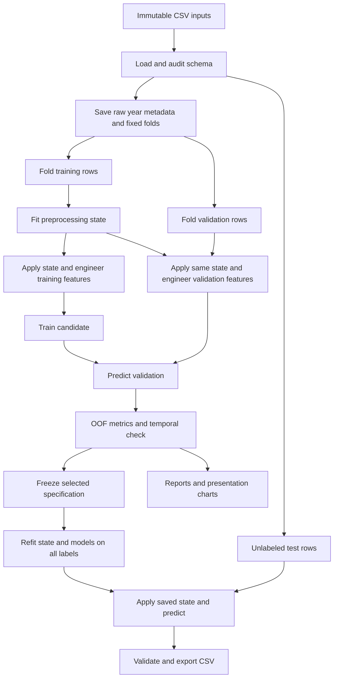

# Architecture and developer contracts

This is the target architecture, not a claim that every listed module exists.
See [docs/STATUS.md](STATUS.md) for current implementation status and
[pipeline.md](../pipeline.md) for the modeling decisions.

## Data flow



There is no arrow from validation targets or test rows to fitted preprocessing.
Temporal validation uses the same fit/apply path with a different split.

## File layout

```text
step01_ingest.m                 existing beginner entry point
run_pipeline.m                 planned complete entry point
config/defaultConfig.m         planned central configuration
src/loadBuildingData.m         existing CSV loader
src/auditData.m                planned distribution/sentinel audit
src/makeValidationSplits.m     planned shared folds and temporal split
src/fitPreprocessor.m          planned statistics and category policies
src/applyPreprocessor.m        planned deterministic application
src/engineerFeatures.m         planned feature creation, no target input
src/trainCandidate.m           planned estimator factory
src/crossValidateModels.m      planned OOF orchestration
src/evaluatePredictions.m      planned metrics and slice diagnostics
src/rmse.m                     planned strict metric helper
src/trainFinalModel.m          planned full-data refit
src/predictBuildingEnergy.m    planned bundle-based inference
src/writeSubmission.m          planned guarded export
src/createReport.m             planned charts/tables
tests/                         planned MATLAB function-based tests
data/                          existing competition CSVs
artifacts/<run-id>/             planned model/config/metrics outputs
docs/                          handoff, resources, presentation and status
```

Keep the supplied starter and existing teammate files intact. Generated model
bundles can be large; keep them local unless a deliberate release artifact is
needed. Existing tracked CSVs remain tracked; do not introduce additional raw
data copies, runtime preference folders or credentials into commits.

## Function contracts

| Function | Inputs | Outputs and invariants |
| --- | --- | --- |
| loadBuildingData | dataDir | Existing six outputs XTrain,yTrain,XTest,trainID,testID,report; extend with optional seventh meta output preserving raw year factors before category alignment |
| auditData | raw predictors, target, metadata | Summary tables, validity-rule decisions; no mutation of original CSVs |
| makeValidationSplits | training IDs, raw years, seed | Fixed foldID vector, temporal masks, split metadata; every random-fold row assigned once |
| fitPreprocessor | fold-training X, configuration | Serializable state with no validation/test statistics |
| applyPreprocessor | X, fitted state | Clean table and audit counts; same rows and order |
| engineerFeatures | cleaned X, metadata, feature specification | Table with saved feature names/order; no targets accepted |
| trainCandidate | XFit,yFit, candidate specification, seed | Trained estimator, timing, effective parameters |
| crossValidateModels | raw X,y,metadata,splits,candidates,config | OOF matrix n-by-candidates, per-fold metrics, temporal results |
| evaluatePredictions | actual,predicted,IDs,slices | Pooled RMSE, MAE, residuals, grouped counts/errors |
| trainFinalModel | all labeled data, frozen spec,config | Complete prediction bundle |
| predictBuildingEnergy | bundle,raw test X,metadata | Finite n-by-1 predictions, diagnostics; no fitting |
| writeSubmission | testID,predictions,sample template,path | Reload-verified CSV and validation summary |

The current script continues to work with six outputs after the optional metadata
extension. Do not parse numeric time from already undefined categorical values.

## Configuration contract

`defaultConfig` returns one struct containing Seed=2026, NumFolds=5, input/output
paths, preprocessing thresholds, validity rules, feature flags, candidate structs,
temporal validation masks/policy, clipping policy, and tuning/runtime limits.
Paths resolve relative to the entry file, not the caller's arbitrary current
directory. Verify required toolbox availability before a long run. Core needs
MATLAB and Statistics and Machine Learning Toolbox; parallel processing is optional.
Use MATLAB R2026b here; document any older release actually tested.

Choose candidate settings in configuration rather than duplicating them in
scripts. Record the effective resolved configuration with every experiment.
Create output folders if missing; avoid overwriting prior runs. Proposed run ID:
`yyyyMMdd_HHmmss_<short-commit>`, with a suffix if necessary for uniqueness.

## Preprocessing state

Store Version, InputNames, InputClasses, NumericMedians, FacilityRatingMedians,
FacilityRatingSupport, GlobalRatingMedian, YearBuiltMedian, CategoryLevels,
CategoryModes, MissingIndicatorNames, DroppedColumns, ValidityRules,
FeatureSpec, OutputNames and OutputClasses. Store optional encoding/scaling state
for estimator families that require it. Preserve categories as labels rather
than relying on integer codes that may change across tables.

For fold fitting, rebuild category vocabulary from observed fold-training labels
(remove unused levels inherited from global ingestion). Transform validation
labels using that vocabulary and saved fallback. Native table-based tree models
should receive actual categorical variables, never arbitrary numeric codes.

## Final bundle and experiment artifacts

Bundle fields: SchemaVersion, Models (cell array), Weights, Preprocessor,
FeatureSpec, PredictorNames, PostprocessPolicy, Config, MATLABVersion,
ToolboxVersions, TrainingTimestamp, GitCommit, InputFingerprints and Metrics.
Each model's feature representation must be reproducible; initially keep tree
models on the same feature table to simplify blends. Use `compact` for supported
models when saving if it preserves required inference behavior.

Save `bundle.mat`, `config.mat`, `fold_assignments.csv`, `experiments.csv`,
`oof_predictions.csv`, `metrics.json`, `data_audit.csv`, charts and `submission.csv`
inside the run directory. OOF CSV contains only training IDs and known targets;
submission contains only test IDs and predictions. Record hashes/sizes of input
files so results can be linked to a precise dataset version. A JSON report is a
human/machine summary; the MAT bundle is the authoritative MATLAB inference state.

## Failure handling and test requirements

Fail early on missing files, target contamination of test predictors, schema
mismatch, invalid target, duplicate IDs, all-missing required fields with no
defined fallback, unexpected feature order, and nonfinite predictions. Include
the offending column and stage in errors. Log counts of repairs and category
fallbacks so quality issues are visible.

Meaningful MATLAB tests should cover: leakage protection (extreme validation
values do not change fitted medians), unseen/missing categories, all-missing
facility group fallback, year-7 policy, deterministic folds, metric shape checks,
test ID preservation, serialization equivalence, and CSV round-trip compliance.
Include a small end-to-end synthetic smoke test independent of competition data.
For the full dataset, run ingestion and one small tree before the full ensembles.

## Collaboration boundaries

One owner maintains configuration and interfaces. Other developers work behind
these contracts; agree interface changes before merging. Use short feature
branches, include actual validation commands/results in PRs, and commit only
relevant files. Do not mix unreviewed generated artifacts with source changes.
The documentation handoff is a development specification; implementation gates
are explicitly tracked rather than assumed complete.
